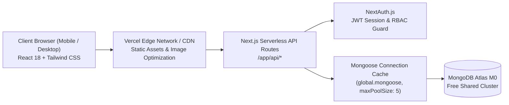
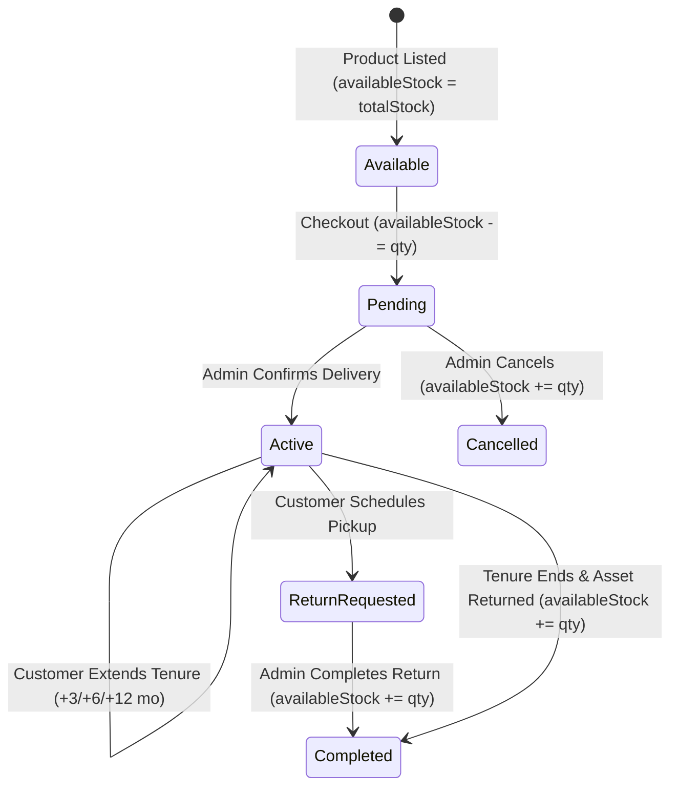
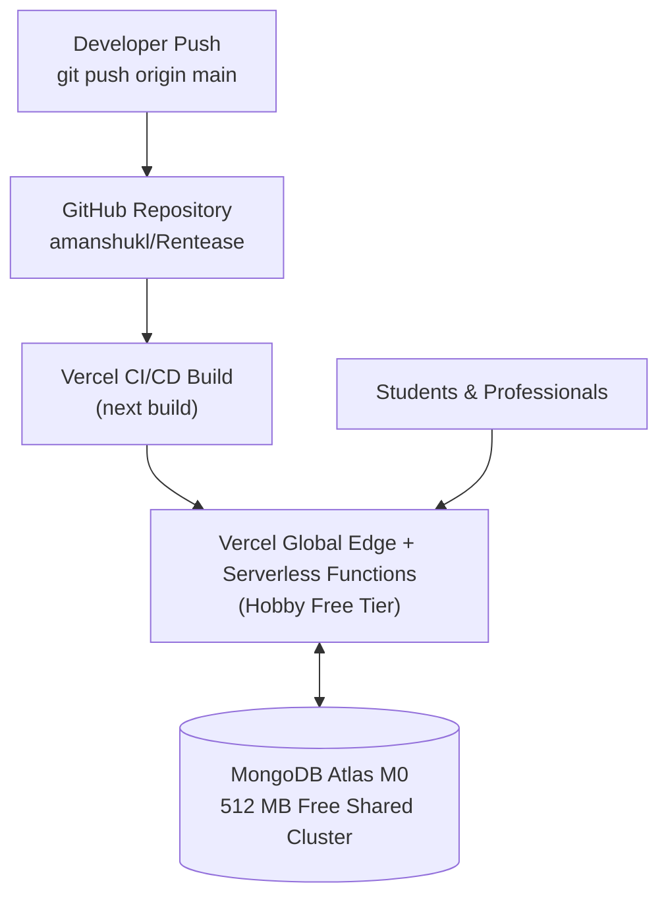

# RentEase – Technical & Architectural Documentation

## 1. Executive Summary & System Architecture

**RentEase** is a full-stack furniture and home-appliance rental platform built on a zero-cost, serverless-first MERN-equivalent architecture powered by **Next.js 14 (App Router)**, **React 18**, **TypeScript**, **Tailwind CSS**, **NextAuth.js**, and **MongoDB Atlas (Mongoose)**.

Rather than maintaining a separate Node.js/Express server that incurs idle hosting costs or cold-start spin-downs on free dynos, RentEase unifies the presentation layer and RESTful backend API inside Next.js Serverless Route Handlers (`/app/api/*`).

### High-Level System Architecture

---

## 2. Database Schema Design

RentEase uses four normalized-yet-document-optimized Mongoose collections tailored for MongoDB's indexing and aggregation engine.

### 2.1 `User` Collection (`models/User.ts`)

| Field | Type | Constraints / Validation | Description |
|-------|------|--------------------------|-------------|
| `name` | `String` | Required, trimmed, max 100 chars | Full name of the account holder |
| `email` | `String` | Required, unique, lowercase, email regex | Login identifier |
| `password` | `String` | Required, min 6 chars, `bcryptjs` (12 salt rounds) | Hashed user credential |
| `role` | `String` | Enum: `user`, `vendor`, `admin`; default `user` | Role-Based Access Control claim |
| `city` | `String` | Optional, trimmed | User/vendor primary service city |
| `phone` | `String` | Optional, trimmed | Contact phone number |
| `address` | `Object` | `{ street, city, state, pincode }` | Saved delivery address |
| `cart` | `Array` | `[{ product: ObjectId, tenure: 3\|6\|12, quantity: >=1 }]` | Server-side cart snapshot |
| `timestamps` | `Date` | `createdAt`, `updatedAt` | Automatic Mongoose audit fields |

### 2.2 `Product` Collection (`models/Product.ts`)

| Field | Type | Constraints / Validation | Description |
|-------|------|--------------------------|-------------|
| `name` | `String` | Required, trimmed, max 200 chars | Product display title |
| `slug` | `String` | Required, unique, lowercase | URL-friendly identifier |
| `description` | `String` | Required, max 2000 chars | Full product specifications |
| `category` | `String` | Enum: `furniture`, `appliance` | Primary catalog vertical |
| `subcategory` | `String` | Required, trimmed | E.g., `Bed`, `Sofa`, `Refrigerator`, `AC` |
| `monthlyRent` | `Number` | Required, `min: 0` | Base 3-month monthly rental rate (INR) |
| `securityDeposit` | `Number` | Required, `min: 0` | Refundable security deposit (INR) |
| `images` | `[String]` | Default `['/images/placeholder.svg']` | Multi-angle product gallery URLs |
| `features` | `[String]` | Default `[]` | Key bullet highlights |
| `dimensions` / `brand` | `String` | Optional | Physical dimensions and manufacturer |
| `condition` | `String` | Enum: `new`, `like-new`, `good` | Asset refurbishment grade |
| `availableStock` | `Number` | Required, `min: 0` | Real-time rentable units available |
| `totalStock` | `Number` | Required, `min: 0` | Total fleet size for utilization KPIs |
| `city` | `String` | Required, default `'Bangalore'` | Service hub where inventory is stocked |
| `isActive` | `Boolean` | Default `true` | Soft-delete visibility flag |

**Indexes:**
- Compound index: `{ category: 1, subcategory: 1 }` for rapid vertical filtering.
- Single-field index: `{ city: 1 }` for multi-city catalog queries.
- Text index: `{ name: 'text', description: 'text' }` for full-text search.

### 2.3 `Order` Collection (`models/Order.ts`)

| Field | Type | Constraints / Validation | Description |
|-------|------|--------------------------|-------------|
| `user` | `ObjectId` | Ref `User`, required | Customer owning the subscription |
| `items` | `Array` | `[{ product, productName, monthlyRent, tenure, quantity, securityDeposit }]` | Price-locked line items at checkout |
| `totalMonthlyRent` | `Number` | Required | Sum of discounted monthly item rents |
| `totalSecurityDeposit` | `Number` | Required | Total refundable deposit |
| `status` | `String` | Enum: `pending`, `active`, `completed`, `cancelled` | Rental lifecycle state |
| `deliveryAddress` | `Object` | `{ street, city, state, pincode }` (required) | Validated delivery destination |
| `startDate` / `endDate` | `Date` | Required | Subscription start and active expiry |
| `returnRequested` | `Boolean` | Default `false` | Pickup scheduling flag |
| `returnDate` | `Date` | Optional | Timestamp when return was requested |
| `extensionLogs` | `Array` | `[{ extendedMonths, previousEndDate, newEndDate, requestedAt }]` | Audit trail for tenure extensions |

**Indexes:** `{ user: 1, status: 1 }` and `{ status: 1 }`.

### 2.4 `Ticket` Collection (`models/Ticket.ts`)

| Field | Type | Constraints / Validation | Description |
|-------|------|--------------------------|-------------|
| `user` / `order` / `product` | `ObjectId` | Required refs to `User`, `Order`, `Product` | Full contextual linkage |
| `subject` / `description` | `String` | Required, max 200 / 2000 chars | Issue summary and details |
| `type` | `String` | Enum: `maintenance`, `return`, `complaint`, `other` | Support workflow category |
| `status` | `String` | Enum: `open`, `in-progress`, `resolved`, `closed` | Triage state |
| `priority` | `String` | Enum: `low`, `medium`, `high` | SLA urgency level |
| `adminNotes` | `String` | Optional | Resolution remarks from ops team |
| `resolutionTime` (Virtual) | `Number \| null` | `updatedAt - createdAt` (ms) when resolved/closed | Powers SLA resolution KPI |

---

## 3. Authentication & Role-Based Access Control (RBAC)

RentEase implements stateless, scalable authentication via **NextAuth.js v4**:

1. **Password Security**: On signup (`/api/auth/signup`), plaintext passwords are never stored; they are salted and hashed with `bcryptjs` (cost factor `12`).
2. **JWT Session Strategy**: Upon successful credential verification in `lib/auth.ts`, NextAuth encodes `id` and `role` (`user` | `vendor` | `admin`) into a signed, HTTP-only encrypted JWT cookie (`maxAge: 30 days`).
3. **Server-Side Route Enforcement**:
   - Every protected API route retrieves the verified session via `getServerSession(authOptions)`.
   - Unauthenticated requests receive `401 Unauthorized`.
   - Admin endpoints (`/api/admin/*`, status transitions on `/api/orders/[id]`, ticket triage on `/api/tickets/[id]`) verify `session.user.role === 'admin'` and return `403 Forbidden` otherwise.
   - Resource ownership checks (`order.user.toString() === session.user.id`) prevent Horizontal Privilege Escalation (IDOR) across customer orders and tickets.

---

## 4. Rental Lifecycle & Inventory Locking

RentEase manages physical rental assets using a deterministic finite-state machine with atomic inventory updates:

### Key Integrity Guarantees
- **Tenure Discounting (`lib/utils.ts`)**: Base rent applies to 3-month rentals, with a 10% discount for 6-month plans and 20% discount for 12-month plans. Discounts are recalculated server-side during `POST /api/orders` to prevent client-side price tampering.
- **Inventory Reservation & Restoration**: `availableStock` is validated and atomically decremented via `$inc: { availableStock: -item.quantity }` at order creation. When an order transitions to `completed` or `cancelled`, inventory is automatically restored via `$inc: { availableStock: +item.quantity }`.
- **Tenure Extensions**: Active subscriptions can be extended by 3, 6, or 12 months via `PATCH /api/orders/[id]` (`{ action: 'extend', newTenure }`), appending an immutable entry to `extensionLogs` and shifting `endDate` forward.

---

## 5. Business KPI Formulas & Analytics Engine

The Admin Analytics endpoint (`GET /api/admin/analytics`) executes parallel MongoDB queries and aggregation pipelines to compute real-time operational KPIs:

1. **Monthly Recurring Revenue (MRR)**:
   $$\text{MRR} = \sum_{o \in \text{ActiveOrders}} o.\text{totalMonthlyRent}$$

2. **Projected Remaining Contract Revenue**:
   $$\text{TotalRevenue} = \sum_{o \in \text{ActiveOrders}} o.\text{totalMonthlyRent} \times \max\left(0, \left\lceil \frac{o.\text{endDate} - t_{\text{now}}}{30\text{ days}} \right\rceil\right)$$

3. **Inventory Utilization Rate (%)**:
   $$\text{UtilizationRate} = \left(\frac{\sum_{p \in \text{ActiveProducts}} (p.\text{totalStock} - p.\text{availableStock})}{\sum_{p \in \text{ActiveProducts}} p.\text{totalStock}}\right) \times 100$$

4. **Customer Retention Rate (%)**:
   Computed via MongoDB `$group` aggregation over `Order` by `user`:
   $$\text{RetentionRate} = \left(\frac{|\{u : \text{orderCount}(u) > 1\}|}{|\{u : \text{orderCount}(u) \ge 1\}|}\right) \times 100$$

5. **Average Ticket Resolution Time (Hours)**:
   $$\text{AvgResolutionTime} = \frac{1}{|T_{\text{resolved}}|} \sum_{t \in T_{\text{resolved}}} \frac{t.\text{updatedAt} - t.\text{createdAt}}{3{,}600{,}000}$$

6. **Revenue by City**:
   Groups `activeOrders` by `deliveryAddress.city` and sums `totalMonthlyRent` to guide city-level fleet expansion.

---

## 6. Multi-City Expansion Architecture

RentEase is architected for horizontal geographic scaling:
- Every `Product` carries an indexed `city` attribute (`Bangalore`, `Mumbai`, `Delhi`, `Hyderabad`, `Pune`, `Chennai`).
- The Catalog API (`GET /api/products?city=Mumbai`) performs case-insensitive indexed filtering, synchronized directly with Next.js URL search parameters (`router.replace`) for shareable city-filtered links.
- Admin product creation (`/admin/products/new`) assigns each SKU to a service city, and the Admin Dashboard tracks MRR per city to identify regional demand hotspots.

---

## 7. Security & Edge-Case Hardening

- **Input Validation (Defense-in-Depth)**: Both client (`app/cart/page.tsx`) and server (`app/api/orders/route.ts`) enforce street length ($\ge 10$ characters), required city/state, and strict Indian 6-digit pincode format (`/^[0-9]{6}$/`).
- **ObjectId Sanitization**: Dynamic `[id]` routes validate `/^[0-9a-fA-F]{24}$/` before querying Mongoose to prevent `CastError` crashes and injection attempts.
- **Secret Management**: Database URIs and JWT secrets are loaded strictly via `process.env`; `.env` is gitignored while `.env.example` contains sanitized placeholders only.
- **Graceful Degradation**: If MongoDB Atlas is unreachable or unseeded, read-only catalog and analytics routes fall back cleanly to `lib/mockData.ts`, and all image components implement `onError` fallback handlers so broken images never degrade UX.

---

## 8. Performance Optimizations for Free-Tier Serverless

- **Global Connection Caching (`lib/db.ts`)**: Stores the Mongoose promise and connection on `global.mongoose` with `maxPoolSize: 5`, `serverSelectionTimeoutMS: 5000`, and `bufferCommands: false` — preventing connection exhaustion on MongoDB Atlas M0's 500-connection shared limit.
- **Lean Queries & Parallel I/O**: All read queries chain `.lean()` to bypass Mongoose document hydration overhead, and independent queries run concurrently via `Promise.all()`.
- **Bounded Pagination**: `GET /api/products` caps `limit` at 50 items and offsets via `.skip().limit()`, keeping payload sizes compact and API latencies well under 3 seconds.
- **Next.js Bundle Optimization**: `next.config.js` configures `serverComponentsExternalPackages: ['mongoose', 'bcryptjs']` and remote image patterns for `images.unsplash.com` and `i.pravatar.cc`.

---

## 9. Deployment Architecture (Zero-Cost Production Pipeline)

